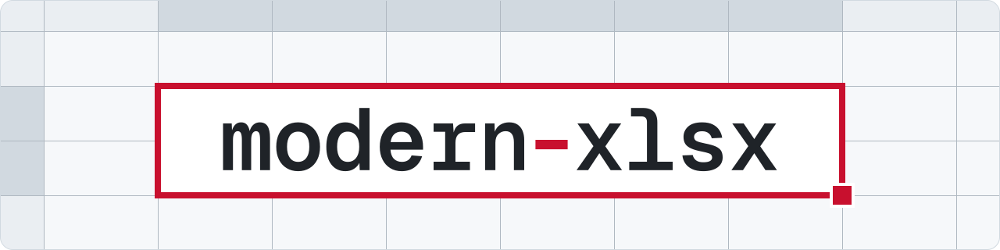

<div align="center">

<picture>
  <source media="(prefers-color-scheme: dark)" srcset="docs/assets/readme/hero-dark.svg">
  
</picture>

**Read, write, style and encrypt Excel `.xlsx` files in JavaScript and TypeScript, with a Rust core compiled to WebAssembly.**

[](https://www.npmjs.com/package/modern-xlsx) [](https://github.com/ABCrimson/modern-xlsx/actions/workflows/ci.yml) [](./packages/modern-xlsx/LICENSE)  

[Guide](./packages/modern-xlsx/README.md)&emsp; [API&nbsp;reference](https://abcrimson.github.io/modern-xlsx/api/)&emsp; [Playground](https://abcrimson.github.io/modern-xlsx/playground.html)&emsp; [Recipes](./docs/examples.md)&emsp; [Comparison](./docs/FEATURE-COMPARISON.md)&emsp; [SheetJS&nbsp;migration](./docs/migration-from-sheetjs.md)&emsp; [ExcelJS&nbsp;migration](./docs/migration-from-exceljs.md)

</div>

modern-xlsx reads and writes `.xlsx` workbooks with cell styles, number formats, data validation, conditional formatting, frozen panes, hyperlinks, comments, tables, charts, pivot tables, images and sheet protection, encrypts and decrypts password-protected files, and ships a formula engine, a streaming writer and a CLI.

## Install

```bash
npm install modern-xlsx
```

## Why modern-xlsx

- **One free package for the whole workbook.** Cell styles, conditional formatting, charts, images, pivot tables and password encryption are all in the MIT-licensed package. SheetJS sells them as SheetJS Pro.
- **Fast reads, small files.** In the [benchmark](./packages/modern-xlsx/README.md#performance), reading 100,000 rows of 10 columns took 485 ms against SheetJS's 1,591 ms, and a 10,000-row file came out 2.6 times smaller. Cell-by-cell writes are slower than SheetJS's.
- **Runs where your code runs.** CI tests Node.js 24 and 26, Bun, Deno, Chromium and a Cloudflare Worker. TypeScript types are included, and there are no runtime dependencies.

## Quick start

<!-- quick-start:begin. Keep identical to the Quick Start block in packages/modern-xlsx/README.md; CI checks it with node scripts/check-readme-sync.mjs. -->
```typescript
import * as xlsx from 'modern-xlsx';

await xlsx.initWasm();

// Build a workbook
const wb = new xlsx.Workbook();
const ws = wb.addSheet('Scores');
ws.cell('A1').value = 'Name';
ws.cell('B1').value = 'Score';
ws.cell('A2').value = 'Alice';
ws.cell('B2').value = 95;

// Style the header row
const header = wb.createStyle();
header.font({ bold: true });
const bold = header.build(wb.styles);
ws.cell('A1').styleIndex = bold;
ws.cell('B1').styleIndex = bold;

// Write it and read it back (Node.js,
// Bun, Deno; in a browser, use
// writeBlob(wb) and readBuffer(bytes))
const file = 'scores.xlsx';
await wb.toFile(file);
const back = await xlsx.readFile(file);
const sheet = back.getSheet('Scores');
console.log(sheet?.cell('B2').value); // 95
```
<!-- quick-start:end -->

## Documentation

- [Guide](./packages/modern-xlsx/README.md): the npm package README, with common tasks, runtimes, the API of every feature, limits and [benchmarks](./packages/modern-xlsx/README.md#performance).
- [API reference](https://abcrimson.github.io/modern-xlsx/api/): every export, generated from the source.
- [Recipes](./docs/examples.md): code for each feature, from styling to sheet conversion, and [runnable examples](./examples/README.md) for runtimes, frameworks and deploy targets.
- [Migrating from SheetJS](./docs/migration-from-sheetjs.md) and [from ExcelJS](./docs/migration-from-exceljs.md).
- [Feature comparison](./docs/FEATURE-COMPARISON.md) and [WASM size and speed](./docs/perf-size.md).
- [Changelog](./packages/modern-xlsx/CHANGELOG.md) and [roadmap](./docs/ROADMAP.md).
- [Security policy](./SECURITY.md), with how to report a vulnerability, and the [threat model](./docs/security/threat-model.md).
- [Project wiki](https://github.com/ABCrimson/modern-xlsx/wiki).

## Architecture

<p align="center">
<picture>
  <source media="(prefers-color-scheme: dark)" srcset="docs/assets/readme/architecture-dark.svg">
  
</picture>
</p>

Data crosses the WASM boundary as a JSON string that the TypeScript side parses with `JSON.parse`. The Rust core handles ZIP, XML, shared strings and styles.

## Repository structure

```
crates/
  modern-xlsx-core/  Rust core: OOXML parsing and writing, ZIP I/O
  modern-xlsx-wasm/  WASM bridge: wasm-bindgen exports

packages/
  modern-xlsx/       npm package: TypeScript API, tests, benchmarks

docs/                Guides, migration notes, comparison, roadmap, threat
                     model, README images, GitHub Pages site
examples/            Runnable examples: runtimes, frameworks, deploy targets
fuzz/                cargo-fuzz harness for the reader, writer and repair
scripts/             Example checks, version pins, README sync, release prep
```

## Development

```bash
pnpm build:wasm        # full WASM build
pnpm build:wasm:lite   # lite WASM build (no encryption)
pnpm build:ts          # TypeScript build
pnpm test:rust         # cargo test --workspace
pnpm test:ts           # Vitest suite
pnpm lint              # biome check .

# Rust checks CI runs
cargo fmt --all --check
cargo clippy --workspace --all-targets --locked -- -D warnings
```

See [CONTRIBUTING.md](./CONTRIBUTING.md) for the full workflow.

**Toolchain pins:** `rust-toolchain.toml` (dated nightly), `rust-version` in `Cargo.toml` (MSRV, 1.96.0), the `packageManager` field of `package.json` (pnpm), and the exact `devDependencies` pins in `packages/modern-xlsx/package.json`.

## License

[MIT](./packages/modern-xlsx/LICENSE)
